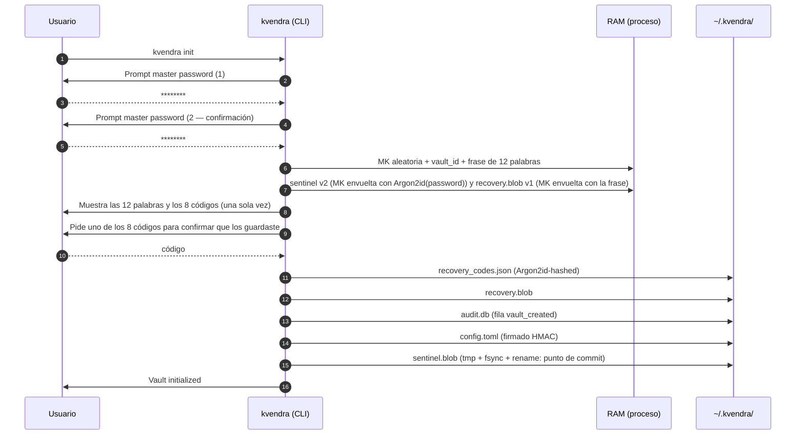

# 4. Bootstrap del vault — `kvendra init`

## Descripción

`kvendra init` crea la estructura `~/.kvendra/` en tu home, genera una **clave de vault aleatoria** (32 bytes) y la guarda **envuelta** dos veces: bajo tu master password (`sentinel.blob`) y bajo una **recovery phrase BIP-39 de 12 palabras** (`recovery.blob`). Además genera un set de **8 recovery codes** numéricos one-time. Es el primer comando que ejecutas tras instalar y solo se ejecuta una vez por vault.

Este capítulo describe el flujo de `0.9.0` paso a paso, qué se persiste, qué tienes que guardar offline y qué pasa si algo falla antes del commit final.

## Prerrequisitos

- Binario `kvendra` instalado y verificable con `kvendra --version` ([capítulo 3](./03-instalacion.md)).
- No existe un `sentinel.blob` en `~/.kvendra/` (si existe, `init` se niega; ver «Vault ya inicializado»).
- Lugar offline donde anotar la recovery phrase y los recovery codes (libreta, gestor de contraseñas separado, caja fuerte). Esto **no** es opcional.

## Flujo end-to-end



Todo el material se construye en RAM antes de tocar el home. Si la confirmación falla, no se escribe nada.

## Pasos detallados

### Paso 1 — Lance el comando

```bash
kvendra init
```

No acepta argumentos posicionales. Banderas reales (`kvendra init --help`):

> **`--password-env <VAR>`** (env: `KVENDRA_INIT_PASSWORD`) — lee el master password de esa variable de entorno en vez de pedirlo por prompt. Para setups CI / no interactivos.
>
> **`--confirm-code <CODE>`** (env: `KVENDRA_INIT_CONFIRM_CODE`) — código de confirmación para saltar el prompt interactivo. Tiene que ser uno de los 8 códigos generados en esa misma ejecución, así que en la práctica solo sirve en tests.
>
> **`--save-to <PATH>`** — guarda la mnemónica BIP-39 y los códigos numéricos en ese fichero (modo `0600`). **Trade-off:** escribirlos a disco anula parte de la garantía offline (ver Paso 3). Si el `init` aborta después, el fichero se borra: su frase pertenecería a un vault que no existe.
>
> **`--no-verify`** — salta el paso de confirmación. **Solo testing.**
>
> **`--home-override <PATH>`** (env: `KVENDRA_HOME`) — reubica el home del vault. Pensado para testing; para mover `~/.kvendra/` en producción use `kvendra config rebind-home` (triple barrera; ver [capítulo 10](./10-recuperacion.md)).

> **Nota:** `kvendra init` **no** tiene un flag `--force` que borre un vault existente.

### Paso 2 — Introduzca el master password

El binario pide la password dos veces (sin echo):

```
Enter a master password (will not echo):
Confirm master password:
```

Reglas:

- Mínimo 8 caracteres.
- Las dos entradas se comparan en tiempo constante. Si no coinciden, se reintenta hasta 3 veces; al tercer fallo el `init` aborta sin escribir nada.

> **Advertencia:** No se persiste, no se sincroniza, no se recupera por email. Si la olvidas, la **recovery phrase** (paso 3) te deja fijar una nueva con `kvendra recover` ([capítulo 10](./10-recuperacion.md)). Los recovery codes **no** sirven para eso.

La clave de vault (MK) es aleatoria; la password solo la envuelve, mediante Argon2id con `m_cost` 64 MiB, `t_cost` 3, `p_cost` 1 y salt aleatoria de 16 bytes. Los parámetros viajan dentro de `sentinel.blob`. Detalle en el [capítulo 12](./12-vault-criptografia.md).

### Paso 3 — Anote la recovery phrase y los 8 códigos

El binario imprime el material de recuperación **una sola vez**:

```
════════════════════════════════════════════════════════════════
  Recovery material — SAVE THESE NOW. They will not be shown again.
════════════════════════════════════════════════════════════════

BIP-39 mnemonic (12 words):
    <word1> <word2> ... <word12>

What the 12 words do: they recover access to THIS vault if you forget the master
password (`kvendra recover`), ...  Anyone with them can set a new password: keep
them offline.

Numeric one-time codes (8 codes):
    NNNN-NNNN-NN
    ...

What the 8 codes do: they authorise `kvendra config rebind-home` only. They do NOT
recover a forgotten password.
```

> **Nota (0.9.0):** el texto del banner menciona también «a new one restored from `kvendra backup`». En 0.9.0 `kvendra backup pull` necesita el `sentinel.blob` de este vault en la máquina (abre el bundle con la password actual), así que restaurar en una máquina nueva solo con backup + frase **todavía no está soportado**. Ver [capítulo 10](./10-recuperacion.md).

> **Advertencia:** la frase es un secreto **del mismo peso que el master password**: quien la tenga junto con una copia de tus ficheros del vault puede fijar una password nueva y leer tus secretos. Si haces screenshot, la copias al clipboard, la escribes en un fichero o la dejas en el scrollback del terminal, ese rastro equivale a la llave del vault. Escríbela a mano o guárdala en un gestor de contraseñas separado.

Diferencias:

| | Recovery phrase | Recovery codes |
|---|---|---|
| Cantidad | 12 palabras BIP-39 (128 bits de entropía) | 8 códigos numéricos `NNNN-NNNN-NN` |
| Storage | Solo offline (tú); en disco solo `recovery.blob`, la MK cifrada bajo ella | `~/.kvendra/recovery_codes.json` (Argon2id-hashed) |
| Uso | Fijar una password nueva si olvidas la actual (`kvendra recover`) | Autorizar `kvendra config rebind-home` |
| Reutilizable | Sí, mientras exista el vault | No, single-use |
| Regenerable | No (solo con un vault nuevo) | Sí: `kvendra config recovery-codes regenerate` |

### Paso 4 — Confirme que los ha guardado

```
To confirm you saved the recovery codes, enter ANY of the 8 numeric codes:
```

Si lo que tecleas no es uno de los 8 códigos, el `init` aborta (`confirmation code did not match a generated recovery code — init aborted`) sin haber escrito nada en el home. Las palabras y códigos se descartan; tendrás que ejecutar `kvendra init` otra vez y anotar el material nuevo.

### Paso 5 — Commit y estructura creada

Tras la confirmación, el binario escribe en este orden: `recovery_codes.json` → `recovery.blob` → `audit.db` (fila `vault_created`) → `config.toml` firmado → **`sentinel.blob`**. El sentinel se publica con fichero temporal + fsync + rename atómico: **ese rename es el punto de commit**. Un fallo antes del rename borra todo lo que esta ejecución escribió.

```
Vault initialized at /Users/<you>/.kvendra
Recovery phrase bound to this vault (recovery.blob).
```

Listado:

```bash
ls -la ~/.kvendra/
```

Ficheros relevantes (todos `0600`; directorios `0700`):

```
sentinel.blob        # v2: MK envuelta con Argon2id(password) + check
recovery.blob        # v1: MK envuelta con la frase (BIP-39 seed + HKDF)
recovery_codes.json  # 8 códigos Argon2id-hashed
config.toml          # firmado HMAC (sub-key kvendra/config-hmac/v1)
audit.db             # SQLite WAL, cadena HMAC con la fila vault_created
```

## Vault ya inicializado

Si `sentinel.blob` ya existe, `init` se niega:

```
vault already initialized. Forgot the master password? `kvendra recover` (needs your
12-word phrase). To change it knowing the current one: `kvendra passwd`.
```

## Init interrumpido

Si un `init` anterior murió (corte de luz, kill) antes del commit, pueden quedar ficheros sueltos sin `sentinel.blob`. El siguiente `kvendra init` **no los borra**: los mueve a `~/.kvendra/.init-orphans-<timestamp>/` y avisa por stderr. Puedes borrar esa carpeta cuando quieras: su frase pertenecía a un vault que nunca existió.

## Validación post-init

Confirme que el unlock funciona antes de cerrar la sesión:

```bash
kvendra unlock
```

Introduzca el master password. La sesión queda activa hasta que expire su TTL (por defecto **4h**; se puede acotar por unlock con `kvendra unlock --ttl 1h`). El TTL vigente se **lee** con `kvendra session info`.

Lock manual:

```bash
kvendra lock
```

Esto zeroiza la clave de vault en RAM y deja el vault locked. El siguiente `unlock` pedirá la password otra vez.

## Notas importantes

> **Nota:** **no** existe `kvendra config set …`: el TTL se ajusta **por unlock** con `kvendra unlock --ttl <30m|4h|8h|1d>`, se **refresca** con `kvendra unlock --extend` y se **consulta** con `kvendra session info`. Ver `PAT-KVD-009` (también en el [capítulo 22](./22-faq-troubleshooting.md)).

> **Nota:** para cambiar la password sabiendo la actual, `kvendra passwd` ([capítulo 10](./10-recuperacion.md)).

> **Advertencia:** No edite manualmente `config.toml`, `recovery_codes.json`, `sentinel.blob` ni `recovery.blob`. `config.toml` va firmado con HMAC y se rechaza si no cuadra; los blobs llevan AAD que los ata a este vault y a su versión de formato, y un fichero alterado se rechaza fail-closed.
