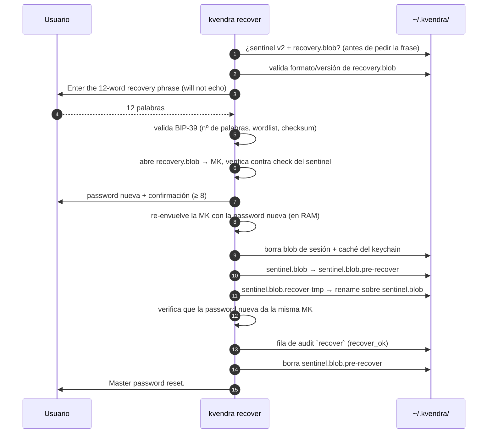

# 10. Recuperación

## Descripción

`kvendra init` entrega al usuario, una sola vez, **dos mecanismos independientes**, y Pro tier añade un tercero:

> **Recovery phrase BIP-39 (12 palabras)** — si olvidas el master password, `kvendra recover` te deja fijar uno nuevo con ella. Desde `0.9.0` la frase está **atada a este vault**: envuelve la clave de vault en `recovery.blob`. Se anota offline; no vive en la máquina.
>
> **Recovery codes numéricos (8 códigos)** — barrera **adicional** sobre el master password para autorizar `kvendra config rebind-home`. Argon2id-hashed en `~/.kvendra/recovery_codes.json`, single-use. **No** recuperan una password olvidada.
>
> **Backup cifrado (`kvendra backup`, Pro tier)** — trae de vuelta **ficheros** del vault, no el **acceso**: se abre con la password actual.

Además, `kvendra passwd` cambia la password **sabiendo la actual**.

Este capítulo explica cuándo se usa cada uno, los flujos paso a paso, los errores posibles y las garantías. Qué te protege y qué no, en llano: [`../security/protection-levels.md`](../security/protection-levels.md).

## Qué vault tienes

Todo lo de recuperación por frase depende del formato del vault:

| Vault creado con | `sentinel.blob` | `recovery.blob` | `kvendra recover` | `kvendra passwd` |
|---|---|---|---|---|
| `0.9.0` o posterior | v2 | sí | **disponible** | disponible |
| `0.8.x` o anterior | v1 | no | se niega, sin cambiar nada | se niega, sin cambiar nada |

`0.9.0` **no migra** vaults antiguos: un vault `0.8.x` sigue abriendo igual que antes, pero su frase nunca se ató al vault y no se puede verificar. En sentido contrario **no hay downgrade**: un binario `0.8.x` no abre un vault creado con `0.9.0`.

## `kvendra recover` — olvidé el master password

### Cuándo usarlo

- Has **olvidado** el master password y tienes la frase de 12 palabras.

**No** es la herramienta para una password **robada**: `recover` mantiene la misma clave de vault, y las copias antiguas de `sentinel.blob` (en backups anteriores, snapshots de disco) siguen abriendo con la password antigua. Si sospechas una filtración de la password o de la frase, crea un vault nuevo y rota las credenciales que guardaba (ver «Password o frase comprometidas»).

### El comando

```bash
kvendra recover
```

Flags (`kvendra recover --help`):

> **`--mnemonic-env <VAR>`** (env: `KVENDRA_RECOVERY_MNEMONIC`) — lee la frase de esa variable en vez del prompt. **Solo testing/CI** con vaults desechables: la frase pesa lo mismo que la password.
>
> **`--new-password-env <VAR>`** (env: `KVENDRA_NEW_PASSWORD`) — lee la password nueva de esa variable. **Solo testing/CI.**

### Flujo



Nada se escribe en el vault antes del commit (pasos 9–14). Solo cambia `sentinel.blob`: secretos, variables locales, allowlists y `config.toml` firmados, grants, backups y la cadena de audit siguen funcionando porque cuelgan de la misma clave de vault.

Salida al terminar:

```
Master password reset. Your secrets, local variables, allowlists, grants and backups keep
working. Active sessions and the keychain cache were cleared; any running
`kvendra mcp serve` keeps its in-memory session until it expires — restart it. If you
suspect the old password was stolen, recovery is not enough: create a new vault.
```

Después: `kvendra unlock` con la password nueva y reinicia los `kvendra mcp serve` que tuvieras abiertos.

### Errores

Todos terminan con «Nothing was changed»: la password antigua sigue vigente.

| Situación | Mensaje (resumen) | Qué hacer |
|---|---|---|
| Vault anterior a `0.9.0` (o sin `recovery.blob`) | `This vault was created before Kvendra 0.9, so its recovery phrase was never bound to it and cannot be verified.` Se muestra **antes** de pedir la frase. | No hay recuperación por frase para ese vault: ver «Vault anterior a 0.9.0». |
| Frase mal formada | `the phrase is not a valid BIP-39 recovery phrase:` + `expected 12 words, got N` / `word #N is not in the BIP-39 English wordlist` / `the checksum does not match (a word is wrong or out of order)` | Revisa la frase anotada. El mensaje da una posición o un número, nunca una palabra. Mayúsculas y espacios extra no importan. |
| Frase válida de otro vault | `the phrase is a valid BIP-39 phrase but it does not belong to this vault.` | Es la frase de otro `init` (por ejemplo, de un vault que recreaste). |
| Material dañado | `recovery material is corrupt or does not match this vault: …` (versión desconocida, `vault_id` que no cuadra con el sentinel, clave recuperada que no verifica) | `recovery.blob` o `sentinel.blob` alterados o de vaults distintos. Restaura los ficheros de este vault (backup) y repite. |

La password nueva debe tener ≥ 8 caracteres y confirmarse (3 intentos).

Cada rechazo deja una línea en `~/.kvendra/audit.preauth.jsonl` (0600, máx. 1000 líneas, sin frase, sin password, vocabulario cerrado). Como no hay clave todavía, no puede ir a la cadena HMAC en ese momento: el siguiente `kvendra unlock` o `kvendra mcp serve` que sí tenga la clave la importa en `audit.db` como fila marcada `preauth_unauthenticated` (p. ej. `recover_rejected_phrase_mismatch`) y vacía el fichero.

### Si se corta a mitad

El commit está pensado para que un corte de luz o un kill en cualquier punto deje un vault que abre con la password **antigua o la nueva**, nunca con ninguna: los dos sentinels envuelven la misma clave, y un fallo en los pasos de publicación restaura el sentinel anterior.

Restos posibles y limpieza:

- `sentinel.blob.recover-tmp` (no publicado): se borra al empezar el siguiente `unlock`, `mcp serve`, `recover` o `passwd`.
- `sentinel.blob.pre-recover` (copia previa): si falta `sentinel.blob`, se vuelve a poner en su sitio; si el sentinel actual abre, el siguiente unlock con éxito la borra y deja la fila `recover_cleanup` en el audit.

Prueba primero la password nueva; si no abre, la antigua.

### Vault anterior a 0.9.0

Si el vault se creó con `0.8.x` o antes y olvidaste la password, no hay forma de recuperarlo: la frase de entonces nunca se ató al vault. La salida es un vault nuevo:

```bash
mv ~/.kvendra ~/.kvendra.old
kvendra init
```

y volver a añadir los secretos (son credenciales re-emitibles en GitHub, AWS, npm…). El vault nuevo ya tiene recuperación por frase.

## `kvendra passwd` — cambiar la password sabiendo la actual

```bash
kvendra passwd
```

Pide la password actual, la nueva y su confirmación, **siempre desde un terminal real** (misma defensa anti-captured-env que `kvendra unlock`). Solo para tests/CI: `KVENDRA_PASSWORD` + `KVENDRA_NEW_PASSWORD` (hacen falta las dos; si falta una, exige terminal).

- La nueva debe tener ≥ 8 caracteres y ser distinta de la actual.
- Password actual incorrecta → rechazo registrado en `audit.preauth.jsonl` (`passwd_rejected_password_invalid`), nada escrito.
- Usa el mismo commit atómico que `recover` (fila de audit `passwd_ok`) y borra igual sesiones y caché del keychain.
- En vaults `0.8.x` se niega: `This vault was created before Kvendra 0.9; changing its password is not supported. Nothing was changed.`

El mensaje final recuerda lo mismo que este capítulo: las copias antiguas de `sentinel.blob` (por ejemplo dentro de backups anteriores) siguen abriendo con la password **antigua**.

## Backup y recuperación

`kvendra backup` (Pro tier) sube un bundle cifrado client-side con una sub-key de la clave de vault. Desde `0.9.0` el bundle incluye `recovery.blob`.

```bash
kvendra login --pro
kvendra backup push --label "antes-de-migrar"
kvendra backup list
kvendra backup pull                 # restaura el último en ~/.kvendra/staging_restore
kvendra backup restore <BACKUP_ID>  # restaura una versión concreta
```

Lo que hace y lo que no, en `0.9.0`:

- **Restaura en un directorio de staging** (`~/.kvendra/staging_restore` o `--out`); tú lo mueves a su sitio.
- **Pide la password actual de este vault** y necesita el `sentinel.blob` de este vault en la máquina. Un backup hecho **antes** de un `recover`/`passwd` se descifra con la password **nueva** (la clave de vault no cambió).
- **Reconcilia el sentinel**: si el bundle es de este vault (mismo `vault_id`, su `check` abre con la clave local), el `sentinel.blob` del staging se sustituye por el actual, para que restaurar no resucite la password olvidada. Lo indica con `The restored sentinel.blob was replaced by this vault's current one`. Un bundle v2 de otro vault se rechaza sin dejar el staging a medias. Las variables locales vuelven como `verified:false` (`kvendra vars verify --all`).
- **No sirve con una password olvidada**: sin la password (o sin fijar antes una nueva con la frase) el bundle no se abre.
- **Máquina nueva**: restaurar desde backup + frase en una máquina sin este vault **todavía no está soportado** (`backup pull` necesita el sentinel local). Si conservas una copia a nivel de ficheros de `~/.kvendra/` (disco, snapshot) que incluya `recovery.blob`, `kvendra recover` funciona sobre ella.

## Recovery codes — autorizar `rebind-home`

### Cuándo usarlos

La acción que **consume un código** es:

> **`kvendra config rebind-home --new-path <PATH>`** — re-anclar el vault a una nueva ubicación tras mover `~/.kvendra/` (REQ-KVD-008). Triple barrera: master password + **un recovery code** + confirmación por TTY.

No confundir con `kvendra config recovery-codes regenerate`, que **no** consume un código: doble barrera (master password + teclear `REGENERATE-RECOVERY-CODES`).

### Paso 1 — Inicie la acción

```bash
kvendra config rebind-home --new-path /Volumes/EncryptedDisk/.kvendra
```

Tras el master password, el binario pide un recovery code.

### Paso 2 — Introduzca un código

Uno de los 8 códigos de `kvendra init`, formato `NNNN-NNNN-NN` (10 dígitos). El binario:

1. Hashea el input con Argon2id con el salt de cada código guardado.
2. Compara con `subtle::ConstantTimeEq`.
3. Match → marca el código `used_at: <now>` y ejecuta la acción.
4. No match → error genérico (no revela cuál falló).

### Garantías

> **Single-use enforced** — un código consumido queda marcado `used_at`; reutilizarlo falla.
>
> **Audit log** — fila `recovery_code_consumed` con el `code_id` y la acción autorizada; los reintentos generan `recovery_code_replay_attempted`.
>
> **Storage** — `~/.kvendra/recovery_codes.json` (0600), hashes Argon2id con salt por código; nunca los códigos en claro.

## Regenerar el set de recovery codes

```bash
kvendra config recovery-codes regenerate
```

Doble barrera: master password + teclear literalmente `REGENERATE-RECOVERY-CODES`. Genera 8 códigos nuevos, sobrescribe `recovery_codes.json`, los muestra una vez y deja la fila `recovery_codes_regenerated`. No toca la frase ni `recovery.blob`.

> **Advertencia:** regenerar invalida el set anterior **completo**.

## Diferencias entre los mecanismos

| | Recovery phrase | Recovery codes | `kvendra backup` |
|---|---|---|---|
| **Qué es** | 12 palabras BIP-39 | 8 códigos numéricos | Bundle cifrado en la nube (Pro) |
| **Storage** | Solo offline (tú); en disco solo la clave de vault cifrada bajo ella (`recovery.blob`) | `recovery_codes.json` (Argon2id-hashed) | Kvendra cloud, cifrado client-side |
| **Para qué** | Password **olvidada** → `kvendra recover` (vaults ≥ 0.9.0) | Autorizar `config rebind-home` | Recuperar **ficheros** del vault |
| **Reutilizable** | Sí, mientras exista el vault | No, single-use | Sí |
| **Regenerable** | No (solo con un vault nuevo) | Sí (`config recovery-codes regenerate`) | Cada `push` |

## Casos de pérdida

### He olvidado la password y tengo la frase

`kvendra recover` (vault ≥ 0.9.0). Ver arriba.

### He perdido la password Y la frase

> **No hay recuperación posible.** Es la promesa zero-knowledge.
>
> Un backup no ayuda: se abre con la password. La salida es un vault nuevo (`mv ~/.kvendra ~/.kvendra.old && kvendra init`) y volver a añadir los secretos. Los tokens originales en GitHub, AWS, npm **siguen siendo válidos**; solo has perdido las copias cifradas.

### He perdido la frase pero recuerdo la password

El vault funciona con normalidad, pero ya no tienes red si olvidas la password. `0.9.0` no permite regenerar la frase de un vault existente: si quieres volver a tenerla, crea un vault nuevo y migra los secretos.

### Password o frase comprometidas

Ni `recover` ni `passwd` echan a quien ya tiene la password o la frase (la clave de vault no cambia y las copias antiguas siguen abriendo). Crea un vault nuevo y **rota cada credencial** que guardaba en su servicio.

### He perdido los recovery codes pero recuerdo la password

Solo hacen falta para `config rebind-home`. Regenera: `kvendra config recovery-codes regenerate`.

## Notas importantes

> **Advertencia:** la frase pesa lo mismo que el master password: quien la tenga junto con una copia de tus ficheros del vault puede fijar una password nueva. Si la guardas en `recovery-phrase.txt` en la misma máquina, has anulado la garantía. Debe vivir fuera del dispositivo (papel, gestor de contraseñas separado, caja fuerte). En enterprise: *split knowledge* — frase a un custodio, códigos a otro.
