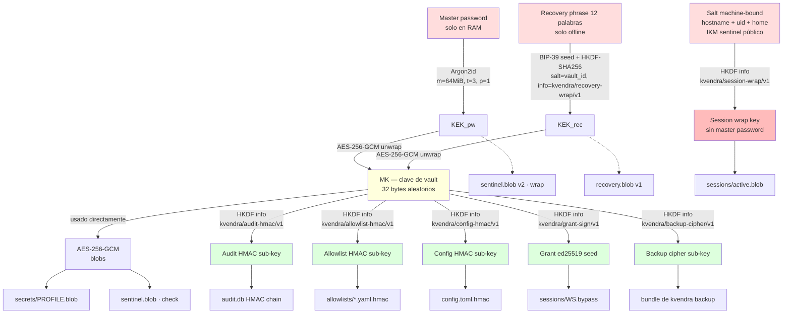

# 12. Vault y criptografía

## Descripción

El **vault** es la pieza fundacional del threat model Nivel 2 zero-knowledge. Vive enteramente en la máquina del usuario. Almacena blobs cifrados con AES-256-GCM bajo la **clave de vault (MK)**. Desde `0.9.0` la MK son 32 bytes aleatorios que **nunca** se derivan de la password: se guardan solo **envueltos** (jerarquía *envelope*), una vez bajo la master password (`sentinel.blob` v2) y otra bajo la recovery phrase (`recovery.blob` v1). La MK vive en claro solo en RAM mientras el vault está unlocked y se zeroiza al lock o al timeout. En Pro tier existe `kvendra backup` (bundle cifrado client-side antes de subir), pero el plaintext y la MK jamás cruzan la red.

Este capítulo describe los primitives criptográficos, el layout en disco, la jerarquía de claves (envelope + HKDF para las sub-keys), los formatos `sentinel.blob` v2 y `recovery.blob` v1 y las garantías de manejo de memoria. Las decisiones de diseño detrás están en `ADR-KVD-CLI-4810AF` (envelope y recuperación por frase, 0.9.0), `ADR-KVD-005` (crypto stack), `ADR-KVD-010` (threat model), `ADR-KVD-012` (storage de master password), `ADR-KVD-022` (naming de sub-keys HKDF) y `ADR-KVD-029` (wrap key machine-bound del blob de sesión).

## Layout en disco

```
~/.kvendra/                      mode 0700
├── config.toml                  mode 0600  flags configurables
├── config.toml.hmac             mode 0600  sub-key kvendra/config-hmac/v1
├── sentinel.blob                mode 0600  v2: MK envuelta con Argon2id(password) + check (v1 en vaults 0.8.x)
├── recovery.blob                mode 0600  v1: MK envuelta con la recovery phrase (solo vaults ≥ 0.9.0)
├── recovery_codes.json          mode 0600  8 codes Argon2id-hashed
├── audit.preauth.jsonl          mode 0600  rechazos de recover/passwd antes de autenticar (efímero)
├── secrets/                     mode 0700
│   └── <profile_id>.blob        mode 0600  uno por secret
├── allowlists/                  mode 0700
│   ├── <profile_id>.yaml        mode 0600
│   └── <profile_id>.yaml.hmac   mode 0600  sub-key kvendra/allowlist-hmac/v1
├── sessions/                    mode 0700
│   ├── active.blob              mode 0600  blob de sesión machine-bound (wrap key kvendra/session-wrap/v1)
│   ├── active.blob.hmac         mode 0600  sidecar HMAC del blob de sesión
│   ├── pro.token                mode 0600  bearer JWT Pro tier (kvendra login --pro)
│   ├── pro.id_token             mode 0600  id_token Pro tier (X-Id-Token + claims de session info)
│   ├── pro.refresh_token        mode 0600  refresh_token Pro tier (renueva pro.token y pro.id_token)
│   ├── pro.client_id            mode 0600  client OIDC usado en el login Pro (el refresh usa el mismo)
│   ├── <workspace_id>.token     mode 0600  sesión OIDC de workspace
│   └── <workspace>.bypass       mode 0600  grant break-glass firmado ed25519 (cap. 23)
└── audit.db                     mode 0600  SQLite WAL, HMAC chain
```

Permisos forzados por el binario al arranque, independientemente del `umask` del shell.

## Primitives criptográficos

| Primitive | Crate | Versión | Uso |
|-----------|-------|---------|-----|
| KDF | `argon2` | 0.5 | Master password → clave que envuelve la MK (`sentinel.blob` v2) |
| AEAD | `aes-gcm` | 0.10 | Cifrado de blobs |
| HKDF | `hkdf` 0.12 (sobre `sha2` 0.10) | — | Domain separation para sub-keys |
| HMAC | `hmac` | 0.12 | Audit chain, allowlist sidecar, config sidecar, sidecar del blob de sesión |
| Firma asimétrica | `ed25519-dalek` | 2 | Grants break-glass ([cap. 23](./23-break-glass.md)) |
| Memory clearing | `zeroize` | 1 | `Drop` impls que sobrescriben buffers |
| Constant-time | `subtle` | 2 | Comparaciones de hashes y MACs |
| Mnemonic | `bip39` | 2 | Recovery phrase 12 words (seed → HKDF → clave que envuelve la MK en `recovery.blob`) |

## Argon2id parameters

Cost params canónicos de producción (`KdfParams::high_cost`, calibrados a ≥1 segundo en hardware moderno — `REQ-KVD-002` AC-VAULT-4):

> **`m_cost` = 65536 KiB (64 MiB)**
>
> **`t_cost` = 3 iterations**
>
> **`p_cost` = 1 lane**
>
> **Output length = 32 bytes** (clave AES-256-GCM)
>
> **Algoritmo:** Argon2id, version `0x13` (v1.3)

Salt: **random 16 bytes**, generada en `kvendra init` y en cada cambio de password (`recover` / `passwd`), almacenada en claro en `sentinel.blob` (`kdf.salt`). Los cuatro valores (`m_cost_kib`, `t_cost`, `p_cost`, `salt`) entran en el AAD del wrap, así que alterarlos invalida el tag. Un `sentinel.blob` con parámetros fuera de rango (`m_cost` 8 MiB–1 GiB, `t_cost` ≤ 16, `p_cost` ≤ 8) se rechaza antes de derivar nada (evita que un fichero hostil sea una palanca de agotamiento de memoria).

> **Nota:** los tests usan params reducidos (`m_cost` 19 456 KiB, `t_cost` 2, `p_cost` 1) para no penalizar la suite; siguen siendo Argon2id real. En builds con la feature `test-hooks` (nunca en una build publicada), `KVENDRA_TEST_FAST_KDF=1` baja el coste de `init` para la matriz de fault-injection. La recovery phrase **no** pasa por Argon2id: tiene 128 bits de entropía y se deriva con el seed BIP-39 (PBKDF2 interno) + HKDF.

Verificación AC-VAULT-4: master password incorrecto produce error de descifrado en <2 s. La cost de Argon2id por intento (~1 s) garantiza resistencia a bruteforce remoto del blob exfiltrado (V8 del threat model).

## Derivación de keys

Desde `0.9.0` (vaults v2):



### Domain separation con HKDF

En vaults creados antes de `0.9.0` (sentinel v1) no hay envelope: la MK **es** la salida de Argon2id(password, salt), y no existe `recovery.blob`. Todo lo que cuelga de la MK (sub-keys, blobs) es igual en ambos formatos.

Las constantes canónicas viven junto a su consumidor (todas son byte-strings, no `&str`):

```rust
// src/vault/session.rs
pub const HKDF_INFO_AUDIT_HMAC: &[u8]     = b"kvendra/audit-hmac/v1";
pub const HKDF_INFO_ALLOWLIST_HMAC: &[u8] = b"kvendra/allowlist-hmac/v1";
pub const HKDF_INFO_CONFIG_HMAC: &[u8]    = b"kvendra/config-hmac/v1";
// src/grant/mod.rs
pub const HKDF_INFO_GRANT_SIGN: &[u8]     = b"kvendra/grant-sign/v1";
// src/session/wrap_key.rs
pub const HKDF_INFO_SESSION_WRAP: &[u8]   = b"kvendra/session-wrap/v1";
// src/backup/mod.rs
pub const BACKUP_HKDF_INFO: &[u8]         = b"kvendra/backup-cipher/v1";
```

Cada sub-key se deriva con HKDF-SHA256 con un `info` distinto. **Razón**: separar dominios criptográficos. El sufijo `/v1` permite rotación sin breaking change. Patrón formalizado en `ADR-KVD-022`.

Hay **6 sub-keys vivas**. Cinco (`audit-hmac`, `allowlist-hmac`, `config-hmac`, `grant-sign`, `backup-cipher`) se derivan de la clave del vault, protegida por la master password. La sexta, **`session-wrap`, es la excepción**: se deriva de un salt machine-bound (`hostname` + `uid` + home canónico) y un IKM sentinela **público** (`kvendra-session-wrap-sentinel-v1`), **sin** la master password. Ese diseño (`ADR-KVD-029`) es lo que permite que `mcp serve` reabra la sesión sin re-pedir contraseña — y es exactamente el residual **C3** del [capítulo 18](./18-threat-model.md): un proceso mismo-uid, con el vault desbloqueado, puede reconstruir esa wrap key con solo datos públicos. **No lo confundas** con el seed del grant (`grant-sign`), que sí está sellado bajo la clave maestra y por eso el agente no puede forjar grants.

## `sentinel.blob` — formato y unlock

El parser lee **primero solo** el campo `version` y después el layout de esa versión; una versión desconocida se rechaza fail-closed.

**v2** (vaults creados con `0.9.0` o posterior), JSON con binarios en base64:

```json
{
  "version": 2,
  "vault_id": "<b64, 16 bytes, público>",
  "kdf": { "m_cost_kib": 65536, "t_cost": 3, "p_cost": 1, "salt": "<b64, 16 bytes>" },
  "wrap":  { "nonce": "<b64>", "ciphertext": "<b64: MK cifrada + tag>" },
  "check": { "nonce": "<b64>", "ciphertext": "<b64: constante cifrada bajo la MK>" }
}
```

- `wrap` = AES-256-GCM(KEK_pw, MK), AAD = `kvendra/sentinel-wrap/v2 ‖ 0x00 ‖ vault_id ‖ m_cost ‖ t_cost ‖ p_cost ‖ salt` (enteros big-endian).
- `check` = AES-256-GCM(MK, `kvendra-sentinel-v2`), AAD = `kvendra/mk-check/v2 ‖ 0x00 ‖ vault_id`. Permite verificar una MK candidata (del blob de sesión o de la frase) **sin** la password.

**v1** (vaults `0.8.x`): la MK es la salida de Argon2id y el blob es el AES-GCM de la constante `kvendra-sentinel-v1` bajo ella. `0.9.0` lo sigue abriendo igual.

Flujo de unlock (v2):

1. Usuario introduce master password.
2. Argon2id con los `kdf` del propio `sentinel.blob` → KEK_pw.
3. Abre `wrap` → MK. Tag mismatch → `InvalidMasterPassword`.
4. MK cargada en RAM, sesión activa.

Cambiar la password (`kvendra recover` / `kvendra passwd`) solo reescribe `sentinel.blob`: salt y nonces nuevos, mismo `vault_id`, misma MK. Por eso secretos, variables locales, allowlists y `config.toml` firmados, grants, backups y la cadena de audit siguen valiendo, y por eso **una copia antigua de `sentinel.blob` sigue abriendo con la password antigua** (ver [capítulo 18](./18-threat-model.md)).

## Blobs de secret — formato

Cada `~/.kvendra/secrets/<profile_id>.blob` es un objeto **JSON** (`src/vault/blob.rs`) con los campos binarios en base64:

```json
{
  "version": 1,
  "kdf": { "m_cost_kib": 65536, "t_cost": 3, "p_cost": 1, "salt": "<b64>" },
  "nonce": "<b64>",
  "ciphertext": "<b64>"
}
```

- `version` — versión de formato del blob (`Blob::VERSION = 1`).
- `kdf` — un *shell* de `KdfParams` con salt vacía, solo para que el formato coincida con el del sentinel v1. **No** se deriva nada por blob: el ciphertext va directamente bajo la MK (simplificación documentada en `ADR-KVD-005`).
- `nonce` — nonce de 12 bytes de AES-256-GCM.
- `ciphertext` — el ciphertext AES-GCM (el tag de autenticación de 16 bytes va anexado por `aes-gcm`, no como campo aparte).

Los metadatos no secretos del perfil (`secret_type`, `expiration`, flag `unsafe_raw_token_allowed`, timestamps) se guardan aparte y se consultan con `kvendra secret get-meta` sin descifrar el plaintext.

Inspeccionado fuera de la sesión, un blob es opaco — no hay plaintext detectable (AC-VAULT-2).

## Manejo de memoria — `zeroize`

Tipos canónicos del módulo `vault`:

```rust
#[derive(ZeroizeOnDrop)]
pub struct MasterPassword(SecretBytes);

#[derive(Zeroize, ZeroizeOnDrop)]
pub struct MasterKey([u8; 32]);   // src/vault/envelope.rs — Debug imprime <redacted>

#[derive(ZeroizeOnDrop)]
pub struct SecretPlaintext(Vec<u8>);
```

Reglas estrictas:

> **Nunca** persistido a disco salvo el blob cifrado.
>
> **Nunca** logueado.
>
> **Nunca** en variable de entorno persistida (la one-shot `KVENDRA_PASSWORD` para `audit --verify` es vector O1.env-var explícito y se `unsetenv()` tras lectura).
>
> `zeroize` en cada buffer temporal (impls `ZeroizeOnDrop`).
>
> `subtle::ConstantTimeEq` en comparaciones de hashes/MACs.

## Storage de la clave de vault (post-unlock)

Modos posibles, decisión `ADR-KVD-012`:

| Modo | Storage | Activación |
|------|---------|-----------|
| **Default (RAM-only)** | RAM del proceso `kvendra mcp serve` durante la sesión, zeroizada en lock o idle timeout (default 30 min) | Sin flags |
| **OS keychain ACL** | El keychain almacena un **sentinel-presence flag** (NO la clave de vault); el password sigue siendo requerido en cada unlock pero protegido por biometric ACL `userPresence` (macOS en esta release) | `--use-keychain` en `mcp serve` |
| **Blob de sesión machine-bound** | `~/.kvendra/sessions/active.blob`: la MK va cifrada con la **session wrap key** (`kvendra/session-wrap/v1`, machine-bound, sin master password) + sidecar HMAC + TTL. Permite que cada `mcp serve` reabra la sesión sin re-teclear la contraseña | Escrito por `kvendra unlock` |

> **Decisión clave**: el modo `--use-keychain` **NO almacena la clave de vault** en el keychain. Almacena un sentinel cifrado con una key protegida por biometría; el unlock real sigue requiriendo el master password textual o re-derivar tras `userPresence` confirmation. Esta sutileza cierra el vector L1 GAP_1 + GAP_2.

> **Nota (0.9.0):** `kvendra recover` y `kvendra passwd` borran el blob de sesión y las entradas del keychain antes de publicar el sentinel nuevo. Un `kvendra mcp serve` ya en marcha conserva su sesión en RAM hasta que expira: reinícialo.

> **Advertencia (C3):** el blob de sesión `active.blob` **sí** guarda la MK como payload, cifrada con una wrap key derivada de inputs **públicos** (machine-bound, sin la master password). Es un trade-off consciente (`ADR-KVD-029`) para no re-pedir la contraseña en cada invocación: un proceso mismo-uid con el vault desbloqueado puede recuperar la clave. Es el residual **C3** del [capítulo 18](./18-threat-model.md); el fix real es el hardware-backed wrapping del roadmap (opt-in).

## Idle timeout

`config.toml`:

```toml
[session]
idle_timeout_minutes = 30
```

Comportamiento:

- Cada `tools/call` o cualquier subcomando `kvendra <cmd>` resetea el timer (sliding window, estilo `sudo`).
- Pasados N minutos sin actividad, la `SessionKey` en RAM se zeroiza automáticamente.
- El siguiente call falla con `VaultLocked` — salvo que el blob de sesión `active.blob` siga vigente por su TTL (default 4h, `session.default_ttl_seconds`), en cuyo caso `mcp serve` hace **self-heal**: re-inyecta la MK desde el blob sin reiniciar el cliente.
- En modo `--use-keychain`, el re-unlock dispara el biometric prompt; en modo TTY, hay que ejecutar `kvendra unlock` manual.

`idle_timeout_minutes` (default 30) se lee del bloque `[session]` de `config.toml`; el TTL del blob de sesión se fija con `kvendra unlock --ttl` (default `4h`). **No hay** un `kvendra config set` para estos valores (ver [cap. 15](./15-allowlist-enforcer.md) sobre la firma del `config.toml`): `config` gestiona `keychain`, `approval`, `mcp-password`, `rebind-home`, `recovery-codes` y `telemetry`.

## Sentinel-presence flag (keychain)

Cuando `--use-keychain` está activo, el keychain guarda:

```
service: kvendra
account: vault-sentinel
data:    AES-GCM(sentinel_string, key=biometric-protected)
ACL:     userPresence (Touch ID / Windows Hello / libsecret prompt)
```

El flag NO contiene la clave de vault. Su presencia, descifrable solo con biometric confirmation, autoriza al broker a pedir el master password real para derivar la key. Es una capa de "intent confirmation" sin pasar la key por el keychain.

## `recovery.blob` v1 — la frase envuelve la MK

Generación en `kvendra init` ([capítulo 4](./04-bootstrap-vault.md)):

- **Frase**: 16 bytes de entropía del CSPRNG del sistema → 12 palabras BIP-39 en inglés (128 bits + 4 de checksum). Solo se muestra; nunca se guarda en claro.
- **KEK_rec** = HKDF-SHA256(salt = `vault_id`, IKM = seed BIP-39 de la frase con passphrase vacía, info = `kvendra/recovery-wrap/v1`), 32 bytes.
- **`recovery.blob`**:

```json
{
  "format": "kvendra-recovery",
  "version": 1,
  "vault_id": "<b64, igual que el del sentinel>",
  "kdf": "bip39-seed-empty-passphrase+hkdf-sha256",
  "nonce": "<b64, 12 bytes>",
  "ciphertext": "<b64: MK (32) + tag (16)>"
}
```

  AES-256-GCM(KEK_rec, MK), AAD = `kvendra-recovery ‖ 0x00 ‖ version (u32 BE) ‖ vault_id`.

Al abrirlo (`kvendra recover`), en este orden: `format` y `version` se comprueban antes de interpretar nada; un `vault_id` distinto del del sentinel → `RecoveryMaterialCorrupt` sin derivar nada; tag inválido → `RecoveryPhraseMismatch`; MK recuperada que no abre `check` del sentinel → `RecoveryMaterialCorrupt`.

- **Recovery codes (8 numeric)**: cada uno con su propio salt random, hash Argon2id (cost reducido vs master password). Solo autorizan `kvendra config rebind-home`; **no** tienen relación criptográfica con la MK.

`kvendra backup` incluye `recovery.blob` en el bundle (es la misma MK que cifra el bundle, así que no añade exposición). Detalle de uso en el [capítulo 10](./10-recuperacion.md).

## Vectores criptográficos cubiertos

Resumen mapping a `ADR-KVD-010`:

| Vector | Mitigación criptográfica |
|--------|--------------------------|
| V2 (read access a `~/.kvendra/`) | Argon2id high-cost + AES-256-GCM client-side |
| V3 (Kvendra-team malicious) | La MK nunca cruza red; `kvendra backup` sube el bundle ya cifrado client-side |
| V4 (AWS breach) | Cifrado client-side antes de upload; el KMS de infra no toca los secretos del usuario |
| V8 (remote bruteforce) | Argon2id m=64MiB cost ~1s/intento |

Vectores **aceptados** explícitamente (out of crypto scope):

> O1 (RAM dump unlocked) — la MK vive en RAM. Mitigación post-MVP: hardware-backed wrapping.
>
> O1.env-var (process listing visibility) — `KVENDRA_PASSWORD` env var trade-off para CI. Mitigación: preferir `--password-stdin`.
>
> O3 (side-channel timing) — `subtle::ConstantTimeEq` ayuda pero no es perfecta.

Detalle completo en el [capítulo 18](./18-threat-model.md).

## Notas importantes

> **Nota:** El crate `time` está fijado a `0.3.47` específicamente, post-fix de `RUSTSEC-2026-0009`. No descender de versión accidentalmente. La pinning está en `Cargo.toml` y verificada en CI.

> **Advertencia:** Cualquier modificación al stack criptográfico (cambio de KDF params, cambio de AEAD, cambio de info HKDF) **debe** ir acompañada de:
>
> 1. ADR nuevo en el Kvendra KB documentando la transición.
> 2. Migration path para vaults existentes.
> 3. Bump de la versión de formato en el header de los blobs.
> 4. Test que verifica que un blob v1 sigue siendo descifrable tras la migración.
>
> Romper esto deja a usuarios sin acceso a sus secretos. La política es estricta.

> **Nota (0.9.0):** el paso a envelope **no migra** vaults existentes: un vault `0.8.x` (sentinel v1) sigue abriendo con `0.9.0` sin cambios, pero no tiene recuperación por frase ni `kvendra passwd`. En sentido contrario **no hay downgrade**: un binario `0.8.x` no abre un vault v2.
